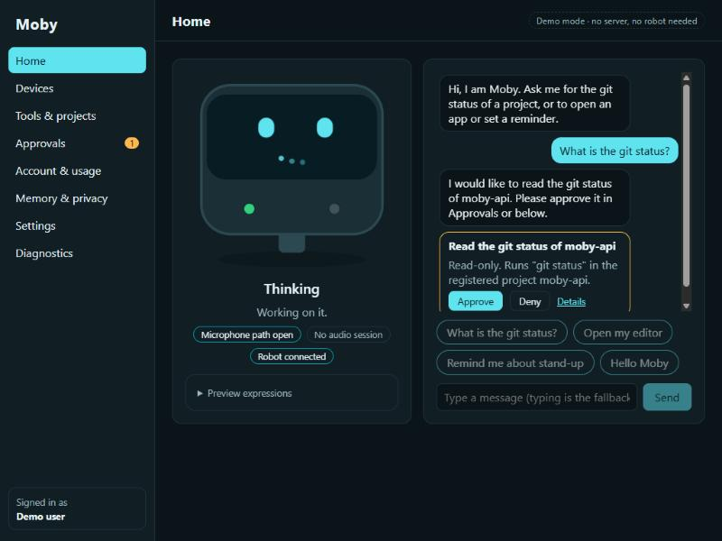
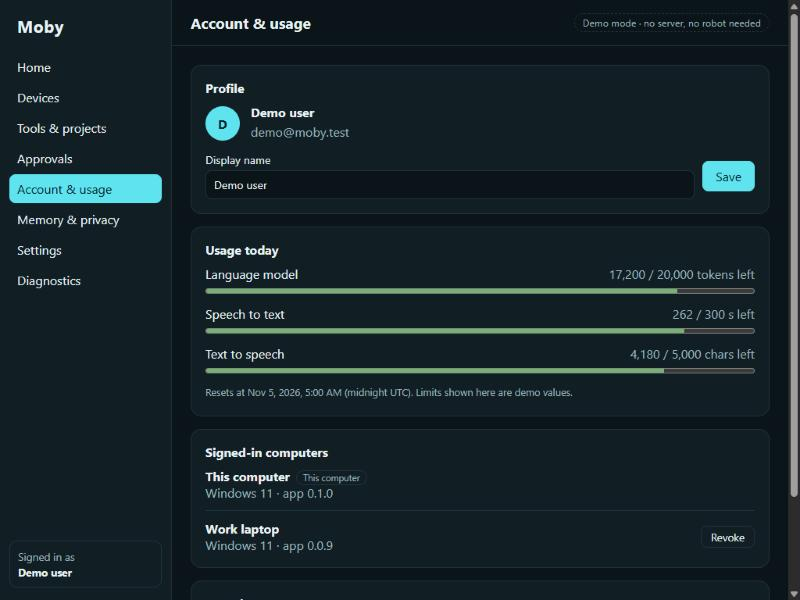
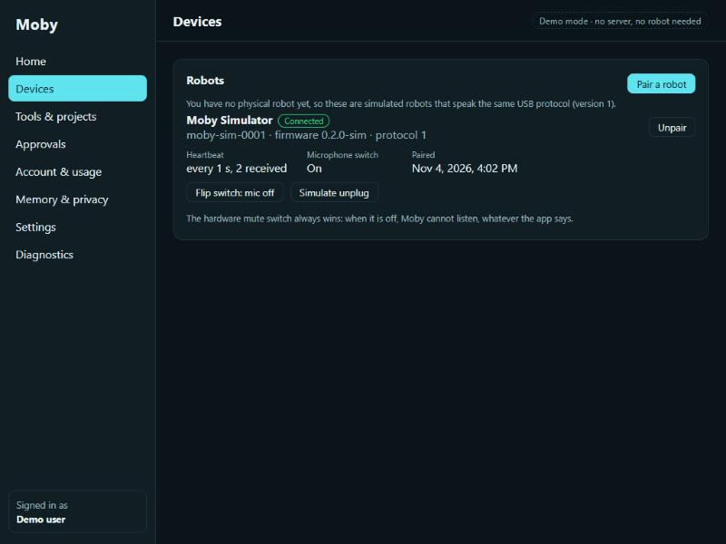
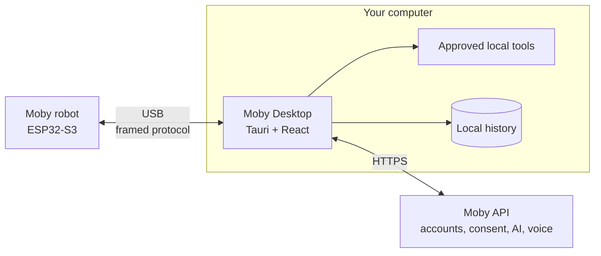

<div align="center">


# Moby Desktop

**The Windows companion app for Moby, a voice-enabled desk robot.**

Talk to your robot, approve what it may do on your computer, and keep your history on your own machine.

[](LICENSE)
[](#building)
[](https://tauri.app)
[](https://react.dev)
[](https://www.typescriptlang.org)
[](#status)

[Overview](#overview) · [Screenshots](#screenshots) · [Status](#status) · [Architecture](#architecture) · [Building](#building) · [Security](#security) · [Contributing](#contributing)

</div>

---

## Overview

Moby is a small ESP32-S3 robot with animated OLED eyes, a push-to-talk button, and a hardware mute switch. **Moby Desktop** is the app that sits between the robot and the rest of your digital life. It is designed to:

- **Talk to the robot over USB.** Audio and status travel over a versioned, framed protocol.
- **Talk to the Moby backend.** Sign-in, consent, usage limits, speech, and the AI model.
- **Run only what you approve.** The model can ask for a tool such as `git_status`. Nothing runs until you say yes, and tools you turn off are refused automatically.
- **Keep your history local.** Conversation history stays on your computer. The server does not store it.
- **Work without a robot.** A virtual Moby with nine animated expressions is built in, so you can try the app today. See [Status](#status) for what is already real.

## Screenshots

<table>
  <tr>
    <td width="50%"></td>
    <td width="50%"></td>
  </tr>
  <tr>
    <td align="center"><sub><b>Approve before it runs.</b> Moby asks, you decide.</sub></td>
    <td align="center"><sub><b>Sign in</b> or continue without an account.</sub></td>
  </tr>
  <tr>
    <td width="50%"></td>
    <td width="50%"></td>
  </tr>
  <tr>
    <td align="center"><sub><b>Usage and account</b> at a glance.</sub></td>
    <td align="center"><sub><b>Simulated robots</b> speak the real USB protocol.</sub></td>
  </tr>
</table>

> The screenshots show demo mode. The data, replies, and tool results are staged, and no command is run.

## Status

Early development. The app runs in **demo mode**: the sign-in, chat, usage, consent, and device screens use an in-memory stand-in for the backend, and the robot is simulated. **No server is contacted and nothing leaves your computer.**

| Area | State |
| --- | :---: |
| App shell, strict CSP, single-instance startup | ✅ |
| Virtual Moby face with nine animated expressions | ✅ |
| Sign-in, profile, usage, installations, consent, tools, approvals, devices, settings, diagnostics screens (demo data) | ✅ |
| Real backend client and token storage in the Windows Credential Manager | 🔜 |
| USB robot link and audio streaming | 🔜 |
| Safe local tools: `git_status`, `open_app`, `open_project`, `search_files`, `create_reminder` | 🔜 |
| Local history database, signed updates, installer distribution | 🔜 |

### Try the demo

1. Start the app and press **Fill in the demo account**, then **Sign in**. You can also choose **Continue without an account**.
2. On **Home**, press **What is the git status?**. Moby thinks, then asks for approval.
3. Press **Approve**. Moby answers, and the face and the usage meters on **Account & usage** change.
4. On **Tools & projects**, turn **Search files** off and ask for a search. Moby refuses without asking.
5. On **Devices**, flip the mic switch or simulate an unplug and watch the face react.

## Architecture



| Layer | Technology | Role |
| --- | --- | --- |
| Shell | Tauri 2, Rust | Window, security policy, native integrations |
| UI | React 19, TypeScript, Vite | Screens and the animated face |
| Contract | `@mobyuz/moby-protocol` | Shared expressions and state transitions |

The face is plain SVG driven by `data-expression` and CSS, so every expression stays distinct even with reduced motion.

## Repository layout

| Path | Purpose |
| --- | --- |
| `src/face/` | The virtual face and per-expression metadata |
| `src/screens/` | One file per screen |
| `src/store.tsx` | App state and the scripted demo agent |
| `src/demo.ts` | In-memory stand-in for the backend, shaped like the Moby API |
| `src-tauri/` | Rust shell, window, CSP, and capabilities |
| `tests/` | Unit tests |
| `docs/adr/` | Architecture decision records |

## Building

You need Windows 11, Git, [Rustup](https://rustup.rs) (the toolchain is pinned in `rust-toolchain.toml`), the Visual Studio C++ Build Tools, and Node 24.13.0 with npm 11.6.2. WebView2 ships with current Windows 11.

> [!IMPORTANT]
> The app depends on `@mobyuz/moby-protocol`, which is **not published yet**. For now it is read from a sibling checkout, and that repository is currently **private**, so outside contributors cannot build the app until the protocol is released. It will be replaced by a pinned package version once the first release exists. See [ADR 0001](docs/adr/0001-desktop-foundation.md).

With access to both repositories:

```powershell
Set-Location D:\repos\moby
gh repo clone mobyuz/moby-protocol
Set-Location .\moby-protocol
npm.cmd ci --ignore-scripts --no-audit --no-fund
npm.cmd run build
Set-Location ..
gh repo clone mobyuz/moby-desktop
Set-Location .\moby-desktop
npm.cmd ci --ignore-scripts --no-audit --no-fund
```

`npm.cmd` avoids the PowerShell execution-policy restriction on `npm.ps1`.

### Run and check

```powershell
npm.cmd run tauri -- dev
npm.cmd run lint
npm.cmd run typecheck
npm.cmd test
Set-Location src-tauri
cargo fmt --all -- --check
cargo clippy --locked --all-targets -- -D warnings
```

### Build the app

```powershell
npm.cmd run tauri -- build --no-bundle
npm.cmd run tauri -- build --bundles nsis
```

The binary is `src-tauri/target/release/moby-desktop.exe`, and the per-user installer (no administrator rights) goes to `src-tauri/target/release/bundle/nsis/`.

> [!TIP]
> A release build compiles a large Windows crate and can use several gigabytes of memory. If the compiler crashes, close other applications or set `CARGO_BUILD_JOBS=1`.

## Security

- The webview has **no filesystem or shell access** and an empty capability set. Each feature will add only the narrowest permission it needs.
- The production content security policy allows only the app's own files.
- Secrets such as refresh tokens will live in the Windows Credential Manager, never in the web layer.
- The model's suggestions are untrusted requests. Tools are allow-listed, scoped to registered projects, and need your approval.
- The hardware mute switch always wins: when it is off, Moby cannot listen, whatever the app says.

Please do not put real credentials in issues or pull requests.

## The Moby project

| Repository | What it contains |
| --- | --- |
| [moby-desktop](https://github.com/mobyuz/moby-desktop) | This app |
| [moby-firmware](https://github.com/mobyuz/moby-firmware) | ESP32-S3 firmware and microphone bench tests |
| [moby-api](https://github.com/mobyuz/moby-api) | Rust backend for accounts, consent, AI, and voice |
| [moby-web](https://github.com/mobyuz/moby-web) | Project website |
| [3d-model](https://github.com/mobyuz/3d-model) | Blender models, parts list, and wiring |

## Contributing

Be kind. This project follows the [Code of Conduct](CODE_OF_CONDUCT.md).

## License

Copyright © 2026 Moby contributors. Released under the [GPL-3.0-only](LICENSE) license.
