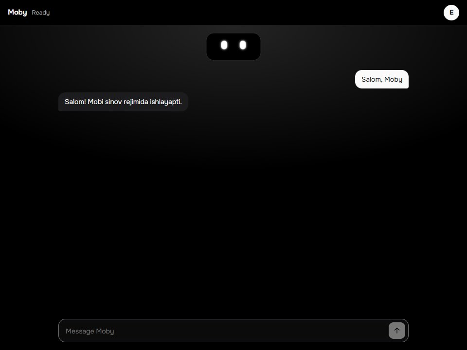
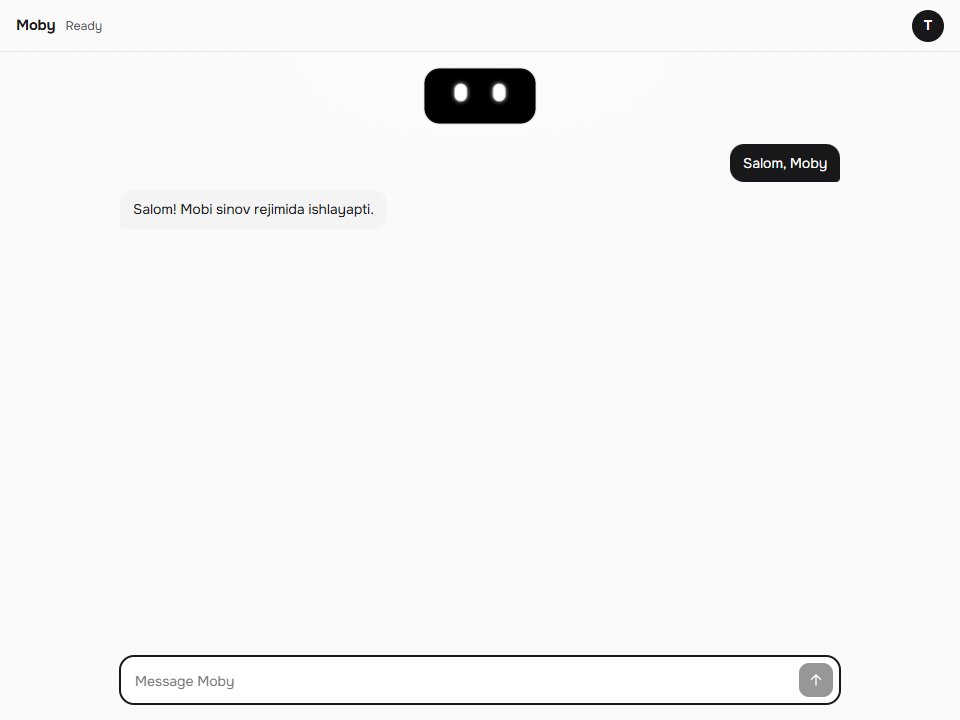
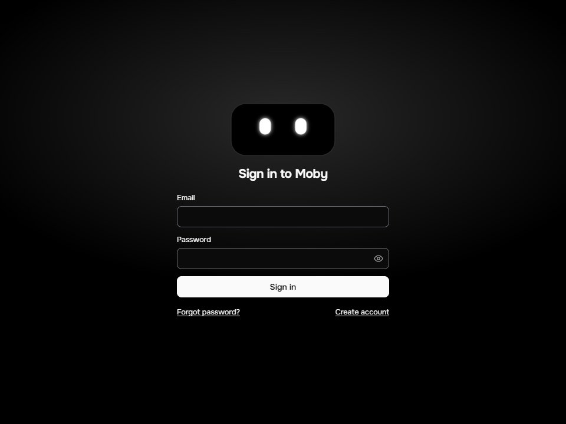
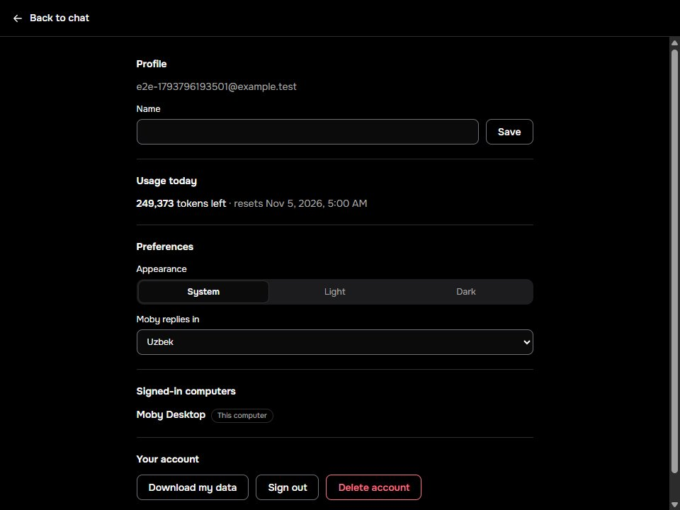
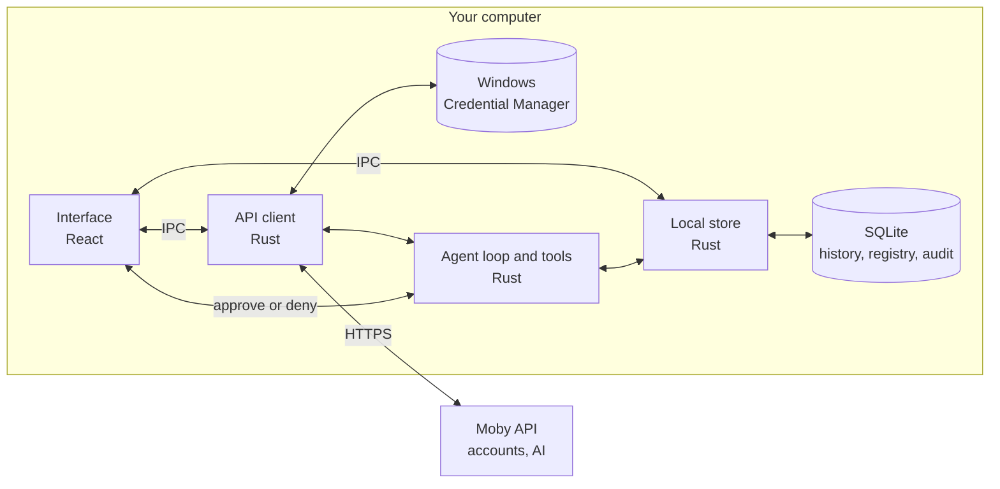

<div align="center">


# Moby Desktop

**The Windows companion app for Moby, a voice-enabled desk robot.**

Chat with Moby from your computer and manage your account.

[](LICENSE)
[](#building)
[](https://tauri.app)
[](https://react.dev)
[](https://www.typescriptlang.org)
[](#status)

[Overview](#overview) · [Screenshots](#screenshots) · [Status](#status) · [Architecture](#architecture) · [Building](#building) · [Security](#security) · [Contributing](#contributing)

</div>

---

## Overview

Moby is a small ESP32-S3 robot with animated OLED eyes, a push-to-talk button, and a hardware mute switch. **Moby Desktop** is the app that connects you to it. Today it does what [moby-api](https://github.com/mobyuz/moby-api) already supports:

- **Sign in.** Create an account, confirm your email, and reset your password. You stay signed in between launches.
- **Chat with Moby.** Replies stream in as they are written, and the face follows along. Conversations are saved on your computer, so you can come back to them.
- **Manage your account.** Change your name, check today's usage, sign other computers out, download your data, or delete your account.
- **Control what is kept.** Choose how long history stays, or delete all of it, under **Settings**. Settings work before you sign in.
- **Let Moby help on this computer, safely.** Add project folders and programs under **Tools and projects**. Moby can then read a project's Git status, search its file names, set reminders, and, after you confirm each time, open a program or a project. **Activity** lists what it did.

## Screenshots

<table>
  <tr>
    <td width="50%"></td>
    <td width="50%"></td>
  </tr>
  <tr>
    <td align="center"><sub><b>Chat</b> in the dark theme.</sub></td>
    <td align="center"><sub><b>Light theme</b>, or follow Windows.</sub></td>
  </tr>
  <tr>
    <td width="50%"></td>
    <td width="50%"></td>
  </tr>
  <tr>
    <td align="center"><sub><b>Sign in</b> once and stay signed in.</sub></td>
    <td align="center"><sub><b>Account</b> and today's usage.</sub></td>
  </tr>
</table>

> The chat reply comes from moby-api's test provider. The account is a test account.

## Status

Early development. Features appear in the app once they work end to end.

| Area | State |
| --- | :---: |
| App shell, strict CSP, single-instance startup | ✅ |
| Virtual Moby face with nine animated expressions | ✅ |
| Email sign-in, registration, password reset | ✅ |
| Tokens in the Windows Credential Manager | ✅ |
| Text chat with `/v1/agent/turn` | ✅ |
| Profile, usage, signed-in computers, data export, account deletion | ✅ |
| Google sign-in | 🔜 |
| Voice chain: robot push-to-talk, consent, speech to text, agent, text to speech, playback on this computer (tested against a simulator and a stub server, **not with a robot, a real speech service or a sound device**) | ✅ |
| USB robot link: connect, pairing, status, reconnect (tested against a simulator, **not on a real robot**) | ✅ |
| Robot speaker playback, wake word | 🔜 |
| Safe local tools with approvals: `git_status`, `open_app`, `open_project`, `search_files`, `create_reminder` | ✅ |
| Local history in SQLite, per account, with retention and delete-all | ✅ |
| Registered folders and programs, read grants, approval dialog, activity log, reminders | ✅ |
| Signed updates, installer distribution | 🔜 |

## Architecture



| Layer | Technology | Role |
| --- | --- | --- |
| Shell | Tauri 2, Rust | Window, security policy, API client, token storage, local history |
| UI | React 19, TypeScript, Vite | Screens and the animated face |
| Contract | `@mobyuz/moby-protocol` | Shared expressions |

The face is `MobyFace` from the shared `@mobyuz/moby-ui` package: plain SVG driven by `data-expression` and CSS, so every expression stays distinct even with reduced motion. The app imports the package's `styles.css` and `mood.css` (the `--moby-mood` colour behind the page glow) and only adjusts the outline colour, the font, and the light/dark choice in `src/app.css`. See [ADR 0008](docs/adr/0008-moby-ui.md).

The interface is black and white, in light and dark themes that you can pick under **Settings**. Colour is reserved for Moby's mood and for status. The tokens live at the top of `src/styles.css`.

## Repository layout

| Path | Purpose |
| --- | --- |
| `src/screens/` | Sign-in, chat, conversation list, tools and projects, activity, settings, and account |
| `src/components/` | The approval dialog |
| `src/store.tsx` | App state and the chat turn |
| `src/history.ts` | Limits for what each turn sends, and conversation titles |
| `src/api.ts` | Typed calls to the Rust commands |
| `src-tauri/` | Rust shell, API client, token storage, window, and CSP |
| `src-tauri/src/store.rs` | The SQLite history and settings, and the commands that reach them |
| `src-tauri/src/agent.rs` | The agent turn: request, stream, tool loop, approvals |
| `src-tauri/src/tools/` | `git_status`, `search_files`, program launch, and the checks in front of them |
| `src-tauri/src/robot/` | The USB link to Moby: framing, session, pairing, reconnect, and (development builds only) a simulator |
| `src-tauri/src/voice/` | The voice chain, consent, playback, and (development builds only) the PC microphone |
| `src-tauri/src/paths.rs` | Windows path hardening |
| `src-tauri/src/registry.rs`, `grants.rs`, `scheduler.rs` | Registered folders and programs, grants, activity log, reminders |
| `src-tauri/migrations/` | Versioned SQL schema steps |
| `tests/` | Unit tests |
| `docs/adr/` | Architecture decision records |

## Building

You need Windows 11, Git, [Rustup](https://rustup.rs) (the toolchain is pinned in `rust-toolchain.toml`), the Visual Studio C++ Build Tools, and Node 24.13.0 with npm 11.6.2. WebView2 ships with current Windows 11.

> [!IMPORTANT]
> The app depends on `@mobyuz/moby-protocol` and `@mobyuz/moby-ui`, which are **not published yet**. For now both are read from sibling checkouts (`file:../moby-protocol`, `file:../moby-ui`), and those repositories are currently **private**, so outside contributors cannot build the app until they are released. Each becomes a pinned package version once its first release exists. See [ADR 0001](docs/adr/0001-desktop-foundation.md) and [ADR 0008](docs/adr/0008-moby-ui.md).

With access to both repositories:

```powershell
Set-Location D:\repos\moby
gh repo clone mobyuz/moby-protocol
Set-Location .\moby-protocol
npm.cmd ci --ignore-scripts --no-audit --no-fund
npm.cmd run build
Set-Location ..
gh repo clone mobyuz/moby-ui
Set-Location .moby-ui
npm.cmd ci --ignore-scripts --no-audit --no-fund
npm.cmd run build
Set-Location ..
gh repo clone mobyuz/moby-desktop
Set-Location .\moby-desktop
npm.cmd ci --ignore-scripts --no-audit --no-fund
```

`npm.cmd` avoids the PowerShell execution-policy restriction on `npm.ps1`.

### Run and check

The app talks to `http://127.0.0.1:8080` by default, so start moby-api first (`docker compose up -d` in that repository). Set `MOBY_API_URL` to use another server. It must be HTTPS unless the server runs on this computer. `MOBY_TERMS_VERSION` and `MOBY_PRIVACY_POLICY_VERSION` set at build time must match the server, and default to its `dev-1`.

```powershell
npm.cmd run tauri -- dev
npm.cmd run lint
npm.cmd run typecheck
npm.cmd test
Set-Location src-tauri
cargo fmt --all -- --check
cargo clippy --locked --all-targets -- -D warnings
cargo test --locked
```

### Build the app

```powershell
npm.cmd run tauri -- build --no-bundle
npm.cmd run tauri -- build --bundles nsis
```

The binary is `src-tauri/target/release/moby-desktop.exe`, and the per-user installer (no administrator rights) goes to `src-tauri/target/release/bundle/nsis/`.

> [!TIP]
> A release build compiles a large Windows crate and can use several gigabytes of memory. If the compiler crashes, close other applications or set `CARGO_BUILD_JOBS=1`.

## Security

- The webview has **no filesystem or shell access** and an empty capability set. It can only call the commands in `src-tauri/src/api.rs` and `src-tauri/src/store.rs`.
- The production content security policy allows only the app's own files. All network traffic goes through Rust.
- The refresh token lives in the Windows Credential Manager and the access token in Rust memory. Neither reaches the web layer.
- The app sends tokens only over HTTPS, or to a server on this computer.
- Conversations are saved only on this computer, in a SQLite file in your local Windows profile (`%LOCALAPPDATA%\uz.moby.desktop\moby.db`, which does not roam). The server does not store them, and each account sees only its own. The file is protected by your Windows account and is not encrypted separately ([ADR 0003](docs/adr/0003-local-store.md)). Old conversations are removed after 30 days unless you change that, and **Settings** can delete everything at once, for every account on this Windows user. Deleting your account also deletes its data from this computer.
- If the history file can't be opened, chat still works from memory and the app says nothing is being saved.
- **Local tools** ([ADR 0005](docs/adr/0005-local-tools.md), [threat notes](docs/tool-threat-notes.md)): what the model asks for is a request, never permission. The agent loop runs in Rust; the webview can only approve or deny a dialog that Rust opened. The model supplies ids, never paths or commands: real paths come from the folders and programs you picked in a native dialog, and are checked again before every use (junctions, UNC and device paths, alternate streams, short names and swapped files are refused). Opening a program or a project asks you every time, in a separate Windows window that the app opens and the chat page cannot click, with text the app writes and the real location shown; Cancel is the default (owner decision, 2026-11-05). Reading a project needs the permission you can revoke under **Tools and projects**. There is no shell: programs are started by absolute path, without arguments, and only `.exe` files. `git_status` runs inside Moby with gitoxide and ignores the repository's own filters and hooks ([ADR 0004](docs/adr/0004-git-status.md)). Tool output is cleaned, cut to 8 KiB and marked as untrusted data. At most four tool steps and ten seconds per tool in one request. **Activity** records what was decided, never the contents.

- **Robot link** ([ADR 0006](docs/adr/0006-robot-link.md)): the robot is untrusted input. Frames use the protocol codec, with bounded buffers and counted drops. The pairing key is made in Rust from the operating system's random generator, kept in Windows Credential Manager, and never reaches the page, SQLite or logs. Pairings belong to the Windows user. The hardware mute switch is only ever read. Ports are opened only from a fresh list of USB serial ports. Real USB behaviour is unverified until a board exists.

Please do not put real credentials in issues or pull requests.

## The Moby project

| Repository | What it contains |
| --- | --- |
| [moby-desktop](https://github.com/mobyuz/moby-desktop) | This app |
| [moby-firmware](https://github.com/mobyuz/moby-firmware) | ESP32-S3 firmware and microphone bench tests |
| [moby-api](https://github.com/mobyuz/moby-api) | Rust backend for accounts, consent, AI, and voice |
| [moby-web](https://github.com/mobyuz/moby-web) | Project website |
| [3d-model](https://github.com/mobyuz/3d-model) | Blender models, parts list, and wiring |

## Contributing

Be kind. This project follows the [Code of Conduct](CODE_OF_CONDUCT.md).

## License

Copyright © 2026 Moby contributors. Released under the [GPL-3.0-only](LICENSE) license.
